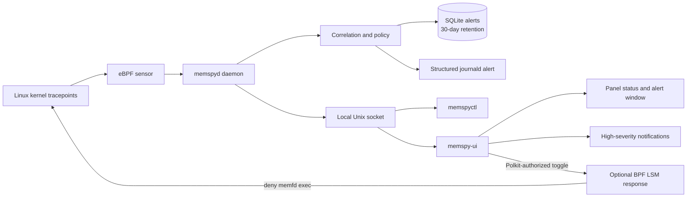

# MemSpy

MemSpy is a local Linux security monitor built with eBPF, libbpf, and C. It watches a focused set of high-confidence fileless execution and process-injection behaviors, retains alerts locally for 30 days, and exposes them through a headless CLI plus an optional unprivileged GTK dashboard. Detection is always available on supported hosts; optional response mode can prevent `memfd` execution when the kernel has BPF LSM enabled.

MemSpy is not a complete endpoint-protection product. Response mode blocks only `memfd` execution; it does not kill processes, quarantine files, inspect payload memory, prevent every fileless technique, or send telemetry.

> **Project status:** development preview (`0.1.0`). The architecture and package definitions are production-oriented, but no kernel or distribution should be considered officially supported until the privileged VM test matrix passes on that exact combination. Test this project in a disposable VM before using it on a workstation.

## Highlights

- CO-RE eBPF sensor using tracepoints and a Linux 5.4-compatible perf buffer
- Privileged system service separated from the unprivileged desktop UI
- High-confidence rules for memory-backed execution, deleted executables, and cross-process writes
- Optional BPF LSM response mode that blocks `memfd` execution, off by default
- Bounded event correlation and explicit degraded-health reporting
- Root-owned SQLite alert storage with automatic 30-day retention
- Parent/grandparent identity, executable hash, systemd, cgroup/container, TTY, SSH-origin, and namespace context
- `memspyctl` for local server administration and JSON export
- Structured journal alerts with stable `MEMSPY_*` fields
- Versioned Unix-domain socket API with read-only alert access and Polkit-authorized response control—no TCP or UDP listener
- High-severity desktop notifications only
- GNOME AppIndicator and KDE Plasma StatusNotifier integration
- Exact rule/path allowlist with fail-closed configuration validation
- Packaging definitions for Ubuntu/Debian, Fedora, and Arch Linux

## Detection rules

| Rule | Severity | Detects |
| --- | --- | --- |
| `MEMFD_EXEC` | High | Execution from a tracked `memfd` or a confirmed memory-backed executable descriptor |
| `DELETED_EXEC` | Medium | A process whose executable image is already marked deleted |
| `PROCESS_VM_WRITE` | Medium | A successful `process_vm_writev` into another process |
| `PTRACE_WRITE` | Medium | A modifying `ptrace` operation against another process |
| `PROC_MEM_WRITE` | Medium | A successful write through a confirmed canonical `/proc/<pid>/mem` descriptor |
| `INJECTION_CHAIN` | High | A cross-process write followed by memory-backed or deleted-image execution within 30 seconds |

These detections are behavioral signals, not proof that a process is malicious. Legitimate debuggers, runtimes, profilers, and security tools can trigger them.

## How it works



The observational eBPF programs collect only the kernel events required by the rules. Policy, enrichment, correlation, storage, and API handling remain in user space. A separate optional BPF LSM program performs the narrow `memfd` execution decision. Quitting the UI stops neither detection nor an already enabled response policy.

## Supported environment

| Component | Requirement |
| --- | --- |
| Architecture | x86_64 only |
| Kernel | Linux 5.4 or newer with readable BTF at `/sys/kernel/btf/vmlinux` |
| Init system | systemd |
| Desktop | Optional: GNOME with AppIndicator support, or KDE Plasma with built-in StatusNotifier support |
| Distribution targets | Ubuntu/Debian, Fedora, and Arch Linux |

The source installer supports Ubuntu, Debian, Fedora, and Arch Linux. Each exact distribution and kernel combination still requires qualification on a clean target-system VM.

## Quick installation

Clone or copy this repository into a supported x86_64 VM, open a terminal in the project directory, and run one command:

```sh
sudo ./install.sh
```

The installer detects the distribution and profile, validates the architecture, kernel, BTF, and systemd, installs only the required dependencies, builds and tests MemSpy, installs it, and starts the daemon. A host without GNOME or KDE automatically receives the headless daemon and CLI profile.

If both desktops are installed and the active one cannot be determined, select it explicitly:

```sh
sudo ./install.sh "$USER" gnome
# or
sudo ./install.sh "$USER" kde
# or install the server profile explicitly
sudo ./install.sh headless
```

Log out and back in after installation so the new `memspy-ui` group membership takes effect. The indicator is configured to start with the desktop session; it can also be launched manually:

```sh
memspy-ui
```

For a headless server, optionally grant one trusted administrator read access and then use the CLI:

```sh
sudo ./install.sh "$USER" headless
# log out and back in once for group membership
memspyctl status
memspyctl alerts --limit 20 --minimum high
memspyctl show 42
memspyctl export 42 > alert-42.json
memspyctl response on
```

`memspyctl` exits with 0 on success, 2 for invalid usage, 3 when the detector is unavailable, 4 for authorization failure, and 5 when an alert is absent. `--json` produces one JSON document on stdout and keeps diagnostics on stderr.

Check the daemon:

```sh
systemctl status memspyd
journalctl -u memspyd
```

## Manual build and test for contributors

The project uses Meson, Ninja, Clang, and bpftool. Core dependencies are libbpf, SQLite, json-c, GLib/GIO, libsystemd, and PolicyKit. GTK 3, Ayatana AppIndicator, and libnotify are required only for `-Ddesktop_ui=enabled`.

Build with AddressSanitizer and UndefinedBehaviorSanitizer, then run every non-privileged test:

```sh
meson setup build --buildtype=debug -Db_sanitize=address,undefined -Ddesktop_ui=enabled
meson compile -C build
ASAN_OPTIONS=detect_leaks=0 \
  meson test -C build --no-suite privileged --print-errorlogs
```

Run the privileged sensor and intentional detection fixtures only as root in a disposable supported VM:

```sh
sudo sh tests/vm/run_matrix.sh build-vm
```

The matrix script intentionally performs memory-backed execution, deleted-image execution, `ptrace`, `process_vm_writev`, and a harmless one-byte `/proc/<pid>/mem` write to verify the rules.

For a release-style install-layout check:

```sh
meson setup build-package --prefix=/usr --buildtype=release
meson compile -C build-package
meson test -C build-package --no-suite privileged --print-errorlogs
sh tests/package/test_install.sh build-package desktop

# Headless build without desktop development libraries
meson setup build-headless --prefix=/usr --buildtype=release -Ddesktop_ui=disabled
meson compile -C build-headless
meson test -C build-headless --no-suite privileged --print-errorlogs
sh tests/package/test_install.sh build-headless headless
```

## Alert storage and access

| Path | Purpose | Access |
| --- | --- | --- |
| `/var/lib/memspy/alerts.db` | SQLite alert database | `root`, mode `0600` |
| `/run/memspy/memspy.sock` | Local alert and response-control API | `root:memspy-ui`, mode `0660` |
| `/etc/memspy/allowlist.conf` | Exact-path allowlist | Administrator managed |
| `/etc/memspy/response-allowlist.conf` | Response launcher exemptions | Administrator managed |
| `/var/lib/memspy/response-mode` | Last confirmed response state | `root`, mode `0600` |
| `/sys/fs/bpf/memspy` | MemSpy response maps and links | MemSpy-owned pins only |

Membership in `memspy-ui` permits a user to read process metadata contained in alerts for every local user. Add only trusted desktop accounts:

```sh
sudo usermod -aG memspy-ui USERNAME
```

The historical group name is retained for compatibility; on servers it grants the same trusted local alert-reader access to `memspyctl`.

## Server operations and journald

Every stored alert is also submitted to journald with `MEMSPY_ALERT_ID`, `MEMSPY_RULE`, `MEMSPY_SEVERITY`, `MEMSPY_ACTION`, `MEMSPY_PID`, `MEMSPY_UID`, and canonical `MEMSPY_ALERT_JSON` fields. High alerts use alert priority and medium alerts use warning priority.

```sh
journalctl -u memspyd -o json-pretty
journalctl -u memspyd MEMSPY_RULE=PROC_MEM_WRITE
journalctl -u memspyd MEMSPY_SEVERITY=high
```

Journal failure degrades health but never blocks SQLite storage or local API publication. Journald retention is administered separately through systemd-journald configuration.

## Allowlist

Each non-comment line contains an exact rule ID followed by an absolute executable path:

```text
MEMFD_EXEC /usr/lib/example/known-memfd-runtime
```

Wildcards and command-line matches are intentionally unsupported. Invalid entries prevent startup instead of silently weakening detection. Restart the daemon after editing the file:

```sh
sudo systemctl restart memspyd
```

## Response mode

Response mode is off by default. On a host with BPF LSM support, the window shows a native **Response mode** switch. Enabling or disabling it asks the desktop PolicyKit agent for administrator authentication; MemSpy itself never reads or stores the password. The UI reports one of four states:

- **Off — Detection only:** alerts are generated, but execution is not prevented.
- **On — Blocking memfd execution:** non-exempt `memfd` execution is denied with `EACCES` and recorded as `BLOCKED_MEMFD_EXEC`.
- **Pending:** MemSpy is waiting for administrator authentication and daemon confirmation.
- **Unavailable:** detection continues, but the daemon-provided reason explains why prevention cannot be enabled.

Check support directly:

```sh
sudo memspyd --check-response
cat /sys/kernel/security/lsm
```

The probe prints `Detection and response available` on a capable host. Otherwise it prints `Detection available; response unavailable: ...` and exits with status 3 without disabling detection. BPF LSM normally appears as `bpf` in `/sys/kernel/security/lsm`; MemSpy does not modify kernel boot parameters.

Each non-comment line in `/etc/memspy/response-allowlist.conf` is an absolute executable path. An entry exempts that launcher from all `memfd` execution blocking, so add only a narrowly reviewed executable. Invalid or unsafe entries are omitted and reported as degraded health instead of silently broadening access. Restart `memspyd` after changes.

Recovery commands:

```sh
sudo systemctl restart memspyd
sudo journalctl -u memspyd -n 100 --no-pager
sudo systemctl stop memspyd
sudo /usr/libexec/memspy/cleanup-bpf
```

The cleanup helper disables response mode and removes only pins below `/sys/fs/bpf/memspy`; use it only while `memspyd` is stopped. `sudo ./uninstall.sh` preserves configuration and alert history. Add `--remove-data` only when that history and the saved response state should be deleted.

## Health states

- **Healthy:** required probes are attached and persistent storage works.
- **Degraded:** detection continues, but events were lost, correlation pressure occurred, descriptor/process enrichment was incomplete, journald failed, or storage is temporarily unavailable.
- **Failed/offline:** required probes did not attach, the host is unsupported, or the UI cannot reach the daemon.

Response support is reported separately from detector health. A host can be healthy for detection while response mode is unavailable because BPF LSM is inactive.

If storage becomes unavailable, the daemon preserves the database, continues with a bounded in-memory alert queue, and retries storage every 60 seconds.

For startup failures, check:

```sh
uname -m
uname -r
test -r /sys/kernel/btf/vmlinux
journalctl -u memspyd -n 100 --no-pager
```

## Privacy and security boundaries

Stored alert fields include timestamps, rule and severity, PID/parent/grandparent identity, UID, executable path, a bounded command line, parent SHA-256, systemd/cgroup/container context, TTY/SSH-origin and namespace IDs, target metadata, successful byte count, and textual evidence. Parent hashes are calculated from the opened executable image and are limited to 128 MiB; unavailable or oversized images leave the alert marked as incomplete. The same canonical alert JSON is locally visible in journald.

The project does not collect:

- process memory or payload bytes
- environment variables
- retained file contents (executables may be read to calculate SHA-256 evidence)
- packet or network content
- remote telemetry

The daemon is privileged because it loads eBPF programs, owns the response policy, and enriches events across users. The UI is deliberately separate and unprivileged. Membership in `memspy-ui` does not authorize response changes; every enable and disable request is independently authorized by PolicyKit. The systemd service restricts filesystem access, capabilities, namespaces, and networking while retaining the permissions required by libbpf.

## Known limitations

- Detection is best-effort for very short-lived processes because `/proc` enrichment can race with process exit.
- `PROC_MEM_WRITE` recognizes canonical numeric procfs descriptors only. If the writer closes or reuses its descriptor before userspace confirms it, MemSpy records an incomplete observation and deliberately emits no alert rather than guessing.
- Bounded kernel maps and queues can lose context under pressure; health changes to degraded rather than hiding the loss.
- The initial rules intentionally favor precision over broad shell, encoded-command, or anonymous-memory heuristics.
- Prevention is limited to `memfd` execution and requires an active BPF LSM; all other rules remain detection-only.
- Blocking `memfd` execution can affect legitimate runtimes and launchers unless they are deliberately exempted.
- ARM64, non-BTF kernels, and non-systemd systems are outside the current scope. The headless profile needs no desktop; the GTK dashboard supports GNOME and KDE Plasma only.

## Repository layout

```text
src/bpf/          eBPF programs and kernel/user ABI
src/daemon/       privileged daemon, policy, storage, and local API
src/common/       canonical alert codec and shared local API client
src/cli/          headless memspyctl client and output formatting
src/ui/           unprivileged GTK indicator and alert window
test-samples/     benign detector validation programs
tests/            unit, integration, UI, packaging, and VM tests
packaging/common/ shared systemd, desktop, PolicyKit, migration, and cleanup assets
config/           default allowlist
docs/             man pages, design specification, and implementation plan
```

## Contributing

Keep changes local-first, bounded, and compatible with the supported Linux 5.4 baseline. New rules should include positive and negative tests, document likely legitimate triggers, and expose event loss or incomplete evidence through health instead of presenting uncertain results as healthy. Prevention changes require explicit authorization, rollback, unsupported-host, and privileged-VM test paths.

Before opening a pull request, run the non-privileged test suite. Changes to probes or detection policy should also pass `tests/vm/run_matrix.sh` in a disposable VM.

## License and release metadata

No project license has been selected yet. Before publishing releases or accepting outside contributions, add a `LICENSE` file and replace placeholder project metadata with the real values.
