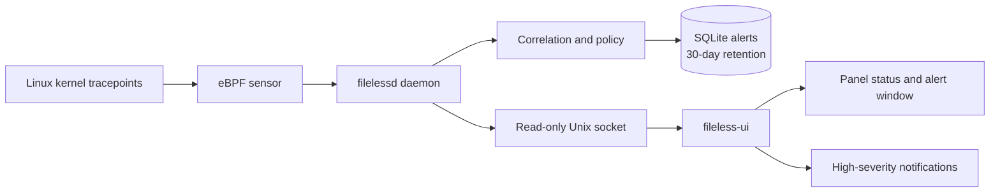

# Fileless Detector

Fileless Detector is a local, detection-only Linux security monitor built with eBPF, libbpf, and C. It watches a focused set of high-confidence fileless execution and process-injection behaviors, retains alerts locally for 30 days, and displays them in a separate unprivileged desktop panel application.

It is not an endpoint protection platform: it does not block execution, kill processes, quarantine files, inspect payload memory, or send telemetry.

> **Project status:** development preview (`0.1.0`). The architecture and package definitions are production-oriented, but no kernel or distribution should be considered officially supported until the privileged VM test matrix passes on that exact combination. Test this project in a disposable VM before using it on a workstation.

## Highlights

- CO-RE eBPF sensor using tracepoints and a Linux 5.4-compatible perf buffer
- Privileged system service separated from the unprivileged desktop UI
- High-confidence rules for memory-backed execution, deleted executables, and cross-process writes
- Bounded event correlation and explicit degraded-health reporting
- Root-owned SQLite alert storage with automatic 30-day retention
- Read-only, versioned Unix-domain socket API—no TCP or UDP listener
- High-severity desktop notifications only
- GNOME AppIndicator and KDE Plasma StatusNotifier integration
- Exact rule/path allowlist with fail-closed configuration validation
- Packaging definitions for Ubuntu/Debian, Fedora, and Arch Linux

## Detection rules

| Rule | Severity | Detects |
| --- | --- | --- |
| `FL-MEMFD-EXEC` | High | Execution from a tracked `memfd` or a confirmed memory-backed executable descriptor |
| `FL-DELETED-EXEC` | Medium | A process whose executable image is already marked deleted |
| `FL-PROCESS-VM-WRITE` | Medium | A successful `process_vm_writev` into another process |
| `FL-PTRACE-WRITE` | Medium | A modifying `ptrace` operation against another process |
| `FL-INJECTION-CHAIN` | High | A cross-process write followed by memory-backed or deleted-image execution within 30 seconds |

These detections are behavioral signals, not proof that a process is malicious. Legitimate debuggers, runtimes, profilers, and security tools can trigger them.

## How it works



The eBPF programs collect only the kernel events required by the rules. Policy, enrichment, correlation, storage, and API handling remain in user space. Quitting the UI does not stop detection.

## Supported environment

| Component | Requirement |
| --- | --- |
| Architecture | x86_64 only |
| Kernel | Linux 5.4 or newer with readable BTF at `/sys/kernel/btf/vmlinux` |
| Init system | systemd |
| Desktop | GNOME with AppIndicator support, or KDE Plasma with built-in StatusNotifier support |
| Distribution targets | Ubuntu/Debian, Fedora, and Arch Linux |

The source installer supports Ubuntu, Debian, Fedora, and Arch Linux. Each exact distribution and kernel combination still requires qualification on a clean target-system VM.

## Quick installation

Clone or copy this repository into a supported x86_64 VM, open a terminal in the project directory, and run one command:

```sh
sudo ./install.sh
```

The installer detects the distribution and desktop user, validates the architecture, kernel, BTF, systemd, and GNOME/KDE environment, installs build dependencies, builds and tests MemSpy, installs it, and starts the daemon. It stops before installing packages if neither GNOME nor KDE is present.

If both desktops are installed and the active one cannot be determined, select it explicitly:

```sh
sudo ./install.sh "$USER" gnome
# or
sudo ./install.sh "$USER" kde
```

Log out and back in after installation so the new `filelessd-ui` group membership takes effect. The indicator is configured to start with the desktop session; it can also be launched manually:

```sh
fileless-ui
```

Check the daemon:

```sh
systemctl status filelessd
journalctl -u filelessd
```

## Manual build and test for contributors

The project uses Meson, Ninja, Clang, and bpftool. Required libraries are libbpf, SQLite, json-c, GLib, GTK 3, Ayatana AppIndicator, and libnotify.

Build with AddressSanitizer and UndefinedBehaviorSanitizer, then run every non-privileged test:

```sh
meson setup build --buildtype=debug -Db_sanitize=address,undefined
meson compile -C build
ASAN_OPTIONS=detect_leaks=0 \
  meson test -C build --no-suite privileged --print-errorlogs
```

Run the privileged sensor and intentional detection fixtures only as root in a disposable supported VM:

```sh
sudo sh tests/vm/run_matrix.sh build-vm
```

The matrix script intentionally performs memory-backed execution, deleted-image execution, `ptrace`, and `process_vm_writev` operations to verify the rules.

For a release-style install-layout check:

```sh
meson setup build-package --prefix=/usr --buildtype=release
meson compile -C build-package
meson test -C build-package --no-suite privileged --print-errorlogs
sh tests/package/test_install.sh build-package
```

## Alert storage and access

| Path | Purpose | Access |
| --- | --- | --- |
| `/var/lib/filelessd/alerts.db` | SQLite alert database | `root`, mode `0600` |
| `/run/filelessd/filelessd.sock` | Read-only local API | `root:filelessd-ui`, mode `0660` |
| `/etc/filelessd/allowlist.conf` | Exact-path allowlist | Administrator managed |

Membership in `filelessd-ui` permits a user to read process metadata contained in alerts for every local user. Add only trusted desktop accounts:

```sh
sudo usermod -aG filelessd-ui USERNAME
```

## Allowlist

Each non-comment line contains an exact rule ID followed by an absolute executable path:

```text
FL-MEMFD-EXEC /usr/lib/example/known-memfd-runtime
```

Wildcards and command-line matches are intentionally unsupported. Invalid entries prevent startup instead of silently weakening detection. Restart the daemon after editing the file:

```sh
sudo systemctl restart filelessd
```

## Health states

- **Healthy:** required probes are attached and persistent storage works.
- **Degraded:** detection continues, but events were lost, correlation pressure occurred, enrichment was incomplete, or storage is temporarily unavailable.
- **Failed/offline:** required probes did not attach, the host is unsupported, or the UI cannot reach the daemon.

If storage becomes unavailable, the daemon preserves the database, continues with a bounded in-memory alert queue, and retries storage every 60 seconds.

For startup failures, check:

```sh
uname -m
uname -r
test -r /sys/kernel/btf/vmlinux
journalctl -u filelessd -n 100 --no-pager
```

## Privacy and security boundaries

Stored alert fields include timestamps, rule and severity, PID/parent PID, UID, process name, executable path, a bounded command line, target-process metadata, and textual evidence.

The project does not collect:

- process memory or payload bytes
- environment variables
- file contents
- packet or network content
- remote telemetry

The daemon is privileged because it loads eBPF programs and enriches events across users. The UI is deliberately separate and unprivileged. The systemd service restricts filesystem access, capabilities, namespaces, and networking while retaining the permissions required by libbpf.

## Known limitations

- Detection is best-effort for very short-lived processes because `/proc` enrichment can race with process exit.
- Bounded kernel maps and queues can lose context under pressure; health changes to degraded rather than hiding the loss.
- The initial rules intentionally favor precision over broad shell, encoded-command, or anonymous-memory heuristics.
- This release provides detection and alerting only—no prevention or remediation.
- ARM64, non-BTF kernels, non-systemd systems, and desktops other than GNOME/KDE Plasma are outside the current scope.

## Repository layout

```text
src/bpf/          eBPF programs and kernel/user ABI
src/daemon/       privileged daemon, policy, storage, and local API
src/ui/           unprivileged GTK indicator and alert window
tests/            unit, integration, UI, packaging, and VM tests
packaging/        systemd, desktop, Ubuntu, Fedora, and Arch packaging
debian/           Debian package metadata
config/           default allowlist
docs/             man pages, design specification, and implementation plan
```

## Contributing

Keep changes detection-only, local-first, bounded, and compatible with the supported Linux 5.4 baseline. New rules should include positive and negative tests, document likely legitimate triggers, and expose event loss or incomplete evidence through health instead of presenting uncertain results as healthy.

Before opening a pull request, run the non-privileged test suite. Changes to probes or detection policy should also pass `tests/vm/run_matrix.sh` in a disposable VM.

## License and release metadata

No project license has been selected yet. The package manifests also contain placeholder maintainer addresses and project URLs. Before publishing release packages or accepting outside contributions, add a `LICENSE` file and replace every `example.invalid` and `invalid.example` value with the real project metadata.
